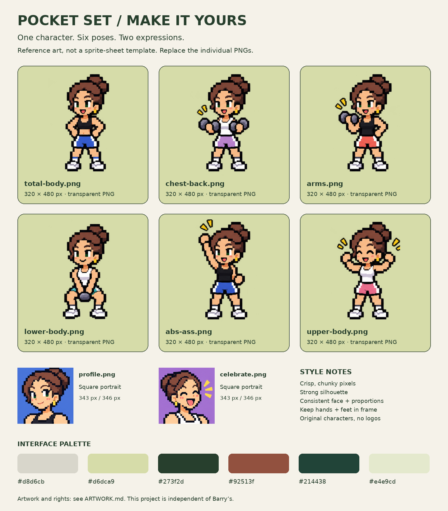

# Pocket Set

A playful dumbbell-weight tracker built around **Barry’s class splits**: choose a class, save the weight per dumbbell, and see the same body-area values in every class that uses them. Independent project, not affiliated with or endorsed by Barry’s. The class/weekday presets are editable in code, not a live studio timetable.

This version uses **Supabase Auth + Postgres row-level security (RLS)**. Sign in to the same Pocket Set account on each device. It stores the latest weight for each of five body areas, not workout history.

## Make it yours

The character is supposed to be you. Create your own original avatar with the [character design kit](docs/design/MAKE_IT_YOURS.md): a [visual reference sheet](docs/design/reference-sheet.png), [copyable prompt](docs/design/CHARACTER_PROMPT.md), and eight easy-to-replace PNG files. You can begin with one pose used in all six slots. No sprite-sheet crop coordinates needed.

Lucie’s personal character is the example, not a generic avatar for shared forks. See [ARTWORK.md](ARTWORK.md) for the distinction between the MIT application code and the personal character art.

## Using an app built from this repo

1. Open Pocket Set and choose **Create an account**. Use your email and a password of at least 12 characters.
2. If Supabase asks you to confirm your email, open its confirmation email, then return to Pocket Set and sign in. The app account is separate from your Supabase dashboard account.
3. On the browser where you used the original device-only version, choose **Import my device weights** after signing in. This is an explicit, one-time import for that account. The original device copy is left unchanged. If an area exists both locally and in the cloud, the newer timestamp wins.
4. Sign in to that same Pocket Set account on another device. The app refreshes on focus, reconnection, and every 30 seconds while visible. You can also choose **Refresh weights**.

This repository is a standalone source copy, not a deployment pipeline. Pushing here does **not** update the existing ChatGPT-hosted Site. Supabase handles app sign-in and data; a public static host need not add another login. You can connect your fork to a static host separately.

### Browser and iPhone icons

The page includes a weight-lifter emoji favicon (16/32/48px ICO and 32px PNG), an opaque 180px Apple touch icon, and the home-screen label **Pocket Set**. The icon uses the app's cream shell and sage screen colors. iOS applies its own outer rounded-corner mask. These are ordinary home-screen bookmark icons; they do not add offline support or change sign-in or stored weights.

The checked-in icon images are generated by `scripts/generate-icons.py` using Pillow and the 🏋️ glyph from [Noto Color Emoji](https://github.com/googlefonts/noto-emoji) (Google Inc. and contributors; SIL Open Font License 1.1). Python and the font are only needed to regenerate them, not for normal app builds. `npm test` checks source icon links, formats, and sizes; after building, `node scripts/test-icons.mjs dist` checks the published files too.

## Run your own copy

Use your own Supabase project rather than someone else's instance.

1. Create a Supabase project and run `supabase/schema.sql` in its SQL editor. The script enables RLS and installs the narrow, security-invoker merge function. It does not delete weight rows. For an existing database, review the policy/grant changes first.
2. Copy `public/config.example.js` to `public/config.js` (git-ignored). Put your project's API URL and **publishable key** in that file. These values are intentionally public. Never put a service-role key, `sb_secret_*` key, password, or private token in client code.
3. Enable the Email provider in Supabase Auth. Keep email verification on for public use.
4. Set **Authentication → URL Configuration → Site URL** to your deployed app URL and allow that exact URL as a redirect. Add a localhost URL only if you need local development. This makes confirmation and recovery links land back in the app.
5. Configure an email provider/SMTP for a wider audience. Supabase's default email service is limited and may restrict recipients. Check current Supabase email limits before sharing your deployment.
6. Use Node.js 22 or later. Install with `npm ci`, run `npm test`, and build with `npm run build`. Serve `dist/` from the root of an HTTPS static host (not a subdirectory). For local development, run `python3 -m http.server 3000 --directory dist` and open `http://localhost:3000`. Add that exact development URL in Supabase redirect settings. Do not open `index.html` directly. For a new ChatGPT Site, create a new Site identity; no hosting identity is included here.
7. Before inviting others, test email delivery, confirmation, sign-in, sign-out, account isolation, and syncing from two separate browsers/devices with your own test accounts.

### Known limitations

This prototype does not expose a self-service password-reset request button. The client recognizes a valid `PASSWORD_RECOVERY` session and shows a new-password form, but a complete reset-request flow is future work. Configure redirects and email delivery before inviting other users. Home-screen bookmarking is supported; offline app installation is not.

## Architecture

- `public/`: source UI, self-hosted art/fonts, Supabase Auth client, and account-scoped sync queue.
- `public/config.js`: public project URL and publishable key.
- `public/sync-core.js`: local cache, durable pending edits, explicit migration, and refresh logic. Each request captures the current account's JWT so an account switch cannot attach an old account's queued edits to a new account.
- `supabase/schema.sql`: table grants, ownership policies, and `merge_my_pocket_set_weights(p_entries jsonb)`.
- `scripts/build.mjs`: bundles the pinned official Supabase client into a static `dist/` build. No third-party script CDN or server secret is needed.
- `scripts/test-client.mjs`: automated model/sync tests.
- `supabase/verify-rls.sql`: transactional database assertions. Test fixtures roll back. Review and run only in a suitable project as its administrator.

The browser sends only changed areas. RLS checks `auth.uid()` against each row's `user_id`. The merge function derives the account from the authenticated JWT, accepts no user ID argument, runs as the caller, and keeps strictly newer timestamps. Equal timestamps preserve the existing cloud value. Anonymous users cannot access the table or function. Users cannot delete rows through the app API.

The old server-only merge RPC, if present in an existing project, stays service-role-only; the new app does not use it. The earlier ChatGPT-to-Supabase bridge is not deployed and is not required.

## Data and privacy notes

- Saved weights and Supabase sessions are cached in the browser. Signing out hides that account's weights but does not erase the original device backup or pending edits. These local copies are not encrypted against someone with access to that browser profile.
- Offline edits are kept in separate queue entries until the server acknowledges them. Keep browser storage enabled. Clearing site data before pending edits sync can lose those unsynced edits.
- Original `pocket-set-weights-v1` values are never overwritten by this version. Older ChatGPT-identity caches are not automatically reassigned to a Supabase account.
- Timestamps depend on device clocks. The server rejects dates more than five minutes in the future; keep device time accurate. This is a small latest-value tracker, not a collaborative conflict-resolution or backup system.
- Do not share exported weights, auth sessions, private configuration, or personal project data with a public repository. Review artwork/font licenses and source content before redistributing.

## Optional future direction: ChatGPT sign-in

A future version could use ChatGPT identity **when its hosting platform supplies a trusted server-side identity**, such as the identity headers supplied to server code on ChatGPT-hosted Sites. That would need a server endpoint that verifies the trusted identity and authorizes every data operation. Database credentials would stay on the server, with an explicit ownership model appropriate to that identity.

This is a different architecture, not a switch you can enable in this app or a claim that Supabase has a turnkey ChatGPT provider. A browser-supplied ID or a ChatGPT hosting session is not automatically a Supabase Auth JWT. Platform capabilities and permissions would need to be checked for that future project. Never bypass RLS by placing a privileged key in the browser.

For this experiment, conventional Supabase Auth keeps the implementation easier to understand and reproduce. The README explains the alternative without implementing or promising it.

## Verification

Automated client tests cover dirty-area writes, explicit migration, preserved device copies, offline/concurrent queues, account switches (including an in-flight request), blocked storage, sign-out, refresh, and stale/equal timestamp conflicts. Database tests cover ownership isolation, anonymous access rejection, permission checks, input validation, and merge behavior. These checks do not replace testing the real email/login flow and two physical devices.

References: [Supabase password authentication](https://supabase.com/docs/guides/auth/passwords), [RLS](https://supabase.com/docs/guides/database/postgres/row-level-security), [redirect URLs](https://supabase.com/docs/guides/auth/redirect-urls), [email setup](https://supabase.com/docs/guides/auth/auth-smtp).

## Contributing and deployment

Fork, configure your own Supabase project, and make changes on a branch. Run the tests and build before proposing a pull request. No user records, production credentials, or deployment identity are included. Never commit your local configuration or session links. GitHub hosting and app hosting are separate choices; connecting auto-deployment later is optional.

## Credits and third-party notices

Built with AI assistance. Pixel art assets were AI-generated. This is an independent experiment, not an official Barry's product or an affiliation with any game franchise. Class labels are editable app presets, not a live studio timetable.

See [THIRD_PARTY_NOTICES.md](THIRD_PARTY_NOTICES.md) for fonts, icon source, and dependencies. Their licenses remain applicable independently of the application license.

## License

Application code is available under the [MIT License](LICENSE). Personal character art is separate; see [ARTWORK.md](ARTWORK.md). Third-party fonts and dependencies retain their own licenses; see [THIRD_PARTY_NOTICES.md](THIRD_PARTY_NOTICES.md).
