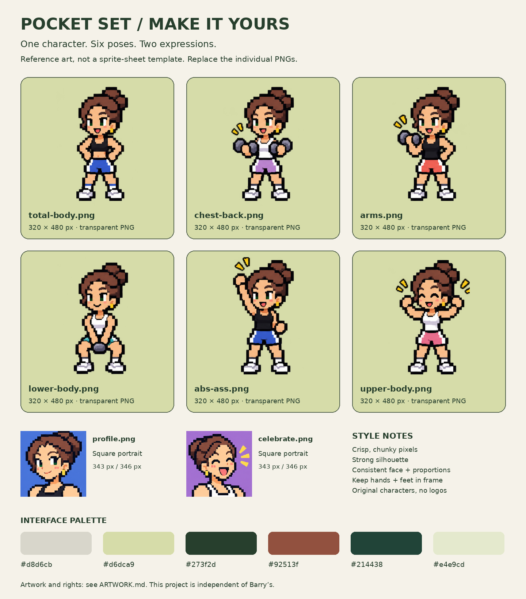

# Make it yours

The character should be **you**. Lucie's character is the personal example in this repository. Build your own original character, or use an avatar you have permission to use.

[Open the full reference sheet](reference-sheet.png) · [Copy the prompt](CHARACTER_PROMPT.md) · [Artwork notes](../../ARTWORK.md)

## A small, friendly workflow

1. Start with one standing character. Describe your appearance, hair, outfit and colors in the prompt, or upload a photo if you so choose.
2. Once you like that character, reuse it as the reference for the other poses. Generate **one image at a time**, not a multi-character sheet. Keep the same face, proportions and pixel scale.
3. Export each image as a PNG with the filename and canvas below. The generator may not produce exact dimensions: crop or pad to the required canvas in an image editor. Keep the whole body inside the frame; do not stretch a wide image into a narrow one.
4. Replace files in `public/assets/characters/`. The app loads these directly, with no sprite-sheet coordinates to edit.
5. Run `npm test`, `npm run build`, then serve `dist/` locally using the README instructions. Try both themes and all six class cards. Check small phone widths and the saved confirmation too.
6. Before publishing your fork, replace the original sheets and example design sheet as well if you do not want Lucie's character in your repository. Update the artwork notes for the assets you created. Keep font and dependency licenses intact.

You can start with **one pose** copied to all six pose filenames, plus two portraits. No animation or six separate designs are required to get started.

## File map

All paths below are under `public/assets/characters/`. Pose images are **320 × 480 px RGBA PNGs** with transparent backgrounds. Center the figure, keep a consistent baseline, and leave room around hands, weights and feet. A roughly 24 px safe margin is a useful target for new art. The app displays these much smaller, so bold shapes beat tiny details.

| Filename | Used for | Suggested pose |
| --- | --- | --- |
| `total-body.png` | Total Body | Standing, hands on hips |
| `chest-back.png` | Chest, Back & Abs | Holding two dumbbells |
| `arms.png` | Arms & Abs | One-arm curl |
| `lower-body.png` | Full Body · Lower Focus | Goblet squat |
| `abs-ass.png` | Abs & Ass | Confident raised arm |
| `upper-body.png` | Full Body · Upper Focus | Flexing / energetic stance |
| `profile.png` | Home greeting | Square head-and-shoulders portrait, calm |
| `celebrate.png` | Save confirmation | Square portrait, happy |

Portraits can be any square PNG at least 128 × 128 px; **384 × 384 px** is a convenient target for new art. Existing crops are 343 × 343 and 346 × 346 px to preserve their original source pixels. Choose transparent or fully filled backgrounds, not accidental white gutters. The app scales them to fit a square with rounded corners. Portrait backgrounds need not match the day/night interface.

The filename order is defined in `public/characters.js`; the class-to-pose mapping is in `public/model.js`. If you only replace files using the same names, no JavaScript changes are needed. The app's area/class presets are code settings, not a live studio timetable.

## Style and palette

The visual idea is a playful handheld game, not a copy of an existing franchise: chunky visible pixels, clean edges, simple shading, recognizable silhouette, and consistent face/outfit across images. Use original characters, not recognizable game characters or Barry's logos. A rendered image can look great but still need cleanup before export.

Interface colors (in `public/style.css`): cream shell `#d8d6cb`, sage screen `#d6dca9`, green ink `#273f2d`, terracotta button `#92513f`, night screen `#214438`, pale night text `#e4e9cd`. These are suggestions for your art, not a required character palette.

## Preview without an account

After building, open `http://localhost:3000/character-preview.html` on the local server. It shows every slot at large and small sizes, both background palettes and a sample card. It makes **no database requests** and contains no real weights or account details. It is included in the static build so a fork can use the same preview page on its own host. Test actual saved-state behavior separately with your own test account.

## What this refactor changes

The app now uses eight individual PNGs rather than cropped CSS backgrounds. The artwork itself is unchanged; the pose crops are centered so the right-column weights/arms are no longer cut off. Original sheets remain at `public/assets/sprites.png` and `public/assets/portraits.png` for reference only; the app no longer loads them. No authentication, saved-data keys or weight logic changed.
